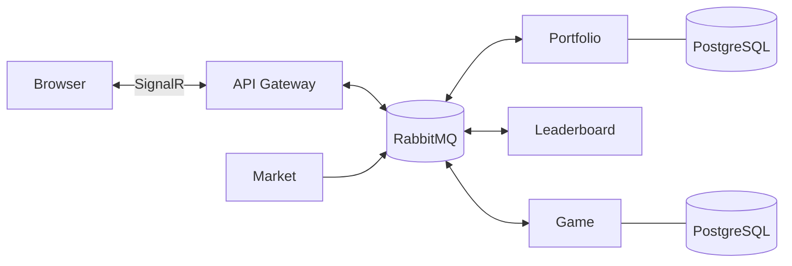

# TradeArena

Realtime multiplayer stock trading game built with C#/.NET microservices, RabbitMQ and SignalR.

Players join with one click, trade five simulated stocks whose prices change every second, and compete on a live leaderboard. Every round starts everyone with $10,000; when the 5-minute timer runs out, the highest net worth wins.

## Run it

Requirements: Docker.

```bash
cd project
docker compose up --build
```

- Game: <http://localhost:8080> (open it in two browsers to play against yourself)
- RabbitMQ management UI: <http://localhost:15672> (user `guest`, password `guest`)

For a quick demo with 1-minute rounds: `ROUND_SECONDS=60 BREAK_SECONDS=10 docker compose up --build`.

## Services

| Service | What it does | Storage |
| :--- | :--- | :--- |
| Market Service | Simulates 5 stocks and publishes all prices every second | – |
| Portfolio Service | Creates players, validates and executes buy/sell orders | PostgreSQL |
| Leaderboard Service | Ranks the players by net worth on every tick | in memory (read model) |
| Game Service | Runs the round timer and stores every round's results | PostgreSQL |
| API Gateway | Serves the web client, hosts the SignalR hub, connects the browser to the broker | – |

The services only talk to each other through RabbitMQ (MassTransit). The browser talks only to the Gateway, over a SignalR WebSocket.



## Documentation

Start at [docs/README.md](docs/README.md):

1. [Overview](docs/01-overview.md): rules, course requirements, services
2. [Architecture](docs/02-architecture.md): the big picture, service responsibilities, data ownership, deployment
3. [Communication](docs/03-communication.md): what happens on a click, messages, step-by-step flows, failure behaviour
4. [Data model](docs/04-data-model.md): database tables, in-memory state, message contracts
5. [API reference](docs/05-api-reference.md): SignalR hub, HTTP endpoints
6. [Running and testing](docs/06-running-and-testing.md): configuration, tests, demo steps
7. [Design decisions](docs/07-design-decisions.md): the four main decisions, course concepts, limitations

## Repository layout

| Path | Contents |
| :--- | :--- |
| `src/Contracts` | Message records shared by all services |
| `src/MarketService` | Price simulator (worker service) |
| `src/PortfolioService` | Trading rules, orders, portfolios (worker service + EF Core) |
| `src/LeaderboardService` | Net-worth ranking (worker service) |
| `src/GameService` | Round timer and history (minimal API + EF Core) |
| `src/Gateway` | SignalR hub, RabbitMQ consumers and the web client in `wwwroot/` |
| `tests/TradeArena.Tests` | xUnit tests for the trading rules, the ranking and the price simulation |
| `docs` | Project documentation |

## Tests

```bash
cd project
dotnet test
```
