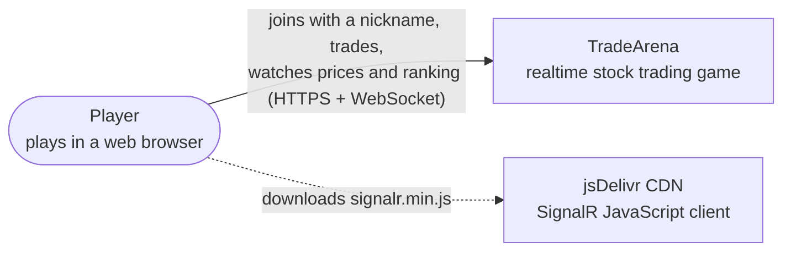
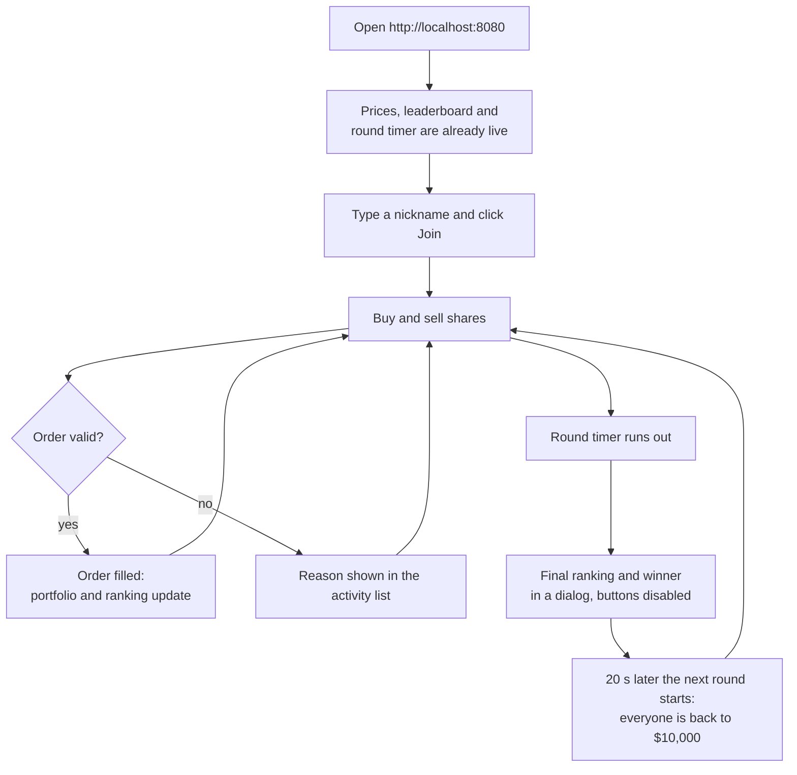

# 01 Overview

TradeArena is a browser game in which players trade a small set of simulated stocks against each other. Prices change every second. Every round starts everyone with the same amount of virtual cash, and when the round timer runs out, the player with the highest net worth wins.

There is no installation and no registration: a player opens the page, types a nickname, clicks **Join** and can trade immediately. Prices, the player's portfolio, the leaderboard and the round timer all update live, without reloading the page.

## Game rules

- Each round lasts **5 minutes**, followed by a **20 second** break with the results. Then the next round starts.
- At the start of each round every player has **$10,000** in cash and no shares.
- Five fictional stocks are traded: `TECH`, `FOOD`, `AUTO`, `BANK` and `GAME`.
- Orders are market orders: buy or sell a whole number of shares at the current price.
- A player cannot spend more cash than they have and cannot sell shares they do not own (no credit, no short selling).
- **Net worth = cash + value of the shares at the latest price.** The leaderboard ranks the players by net worth, and players with the same net worth share a rank.
- During the break no orders are accepted. The final ranking is stored, and past winners stay visible on the page.

## Course requirements

| Requirement | How TradeArena meets it |
|---|---|
| 3–4 microservices | Four services: **Market**, **Portfolio**, **Leaderboard** and **Game**. The API Gateway is the entry point and is not counted. |
| A client | A web client (HTML, CSS, JavaScript) served by the Gateway |
| Any programming language | C# on .NET 10 for every service, JavaScript in the browser |
| Real-time communication | ASP.NET Core SignalR over WebSocket between the browser and the Gateway; RabbitMQ events between the services |
| Documentation in `docs/` | This folder |
| Diagrams in Mermaid | Every diagram in this folder is a Mermaid block |

## Services

| Component | Responsibility | Owns |
|---|---|---|
| **Market Service** | Simulates the stock market and publishes all prices once per second | The current prices (in memory) |
| **Portfolio Service** | Creates players, validates and executes buy and sell orders | Players, shares and executed trades (PostgreSQL) |
| **Leaderboard Service** | Calculates every player's net worth on every tick and ranks them | The live ranking (in memory, built from events) |
| **Game Service** | Runs the round timer and stores the results of each round | Rounds and final rankings (PostgreSQL) |
| API Gateway | The only public entry point: serves the web client, hosts the SignalR hub, turns player actions into messages and pushes events to the browsers | Which browser connection belongs to which player |
| RabbitMQ | Message broker between all services (used through MassTransit) | Queued messages |
| PostgreSQL | One server with a separate database for the Portfolio and the Game Service | – |

## System context

TradeArena does not depend on any external system at runtime. The browser only downloads the SignalR client library from a public CDN.

## A player's journey

A page reload keeps the player: the browser remembers the player id and joins again automatically. **Leave** forgets the player on that browser.

## Technology

| Area | Technology |
|---|---|
| Language and runtime | C# 14, .NET 10 |
| Gateway | ASP.NET Core, SignalR (WebSocket with fallbacks), static files |
| Services | .NET worker services (Market, Portfolio, Leaderboard), ASP.NET Core minimal API (Game) |
| Messaging | RabbitMQ 4 with MassTransit 8.5 |
| Persistence | PostgreSQL 17 with Entity Framework Core 10 (Npgsql) |
| Client | HTML, CSS and plain JavaScript with `@microsoft/signalr` |
| Tests | xUnit |
| Deployment | Multi-stage Dockerfiles and Docker Compose |
