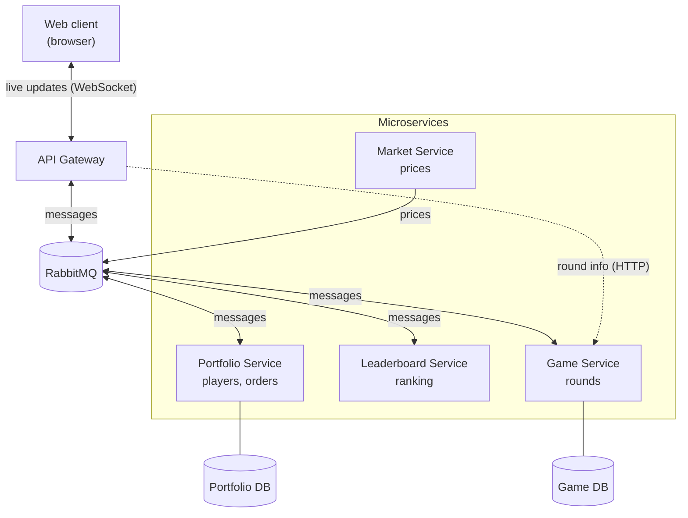
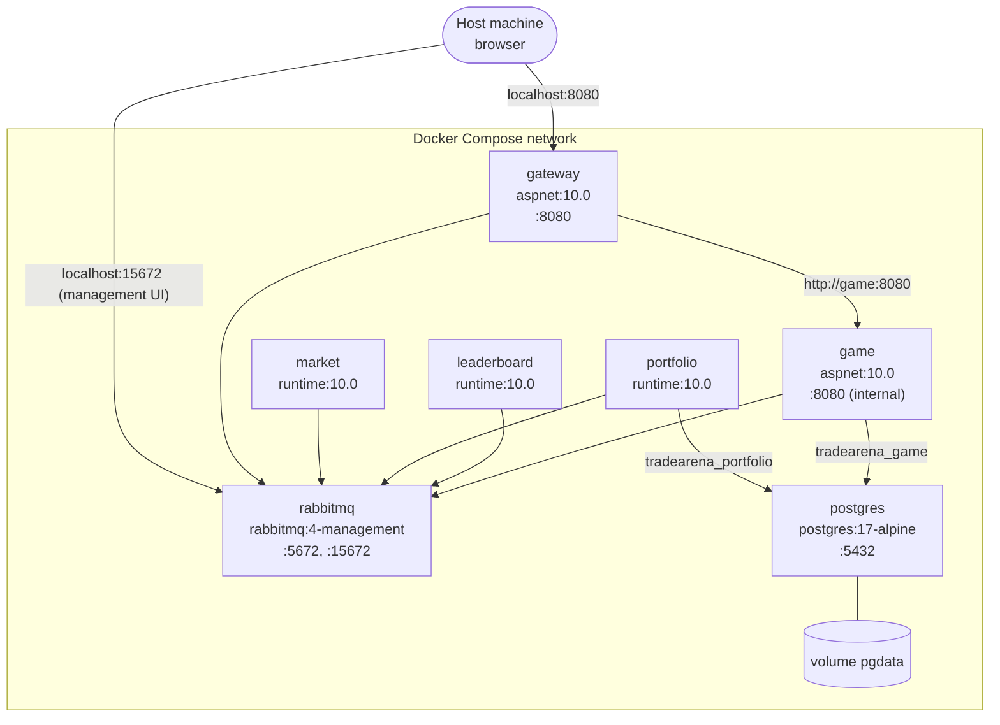

# 02 Architecture

## Container view



The rules behind this picture:

- **The browser only talks to the Gateway.** It keeps one WebSocket connection open for everything live.
- **Services never call each other.** They send and receive messages through RabbitMQ. The one exception is the dotted arrow: when a page opens, the Gateway asks the Game Service over HTTP for the current round and the past rounds.
- **Every service keeps its own data.** Only the Portfolio and Game services have a database, and nobody else touches it.
- **Which message travels where** is listed in [03 Communication](03-communication.md#messages).

## Service responsibilities

### Market Service

A .NET worker (`BackgroundService`) with a `PeriodicTimer` that fires once per second. Each of the five stocks performs a random walk: the new price is the old price changed by a random step between −2 % and +2 %, rounded to cents and never below $1. All prices are published together in one `MarketTick` event. The service does not know who consumes the ticks.

### Portfolio Service

The only service that changes a player's money. It creates a portfolio with $10,000 when a player joins, executes `PlaceOrder` commands at the latest tick price and stores every executed trade. After each change it publishes the result (`OrderExecuted` or `OrderRejected`) and a full `PortfolioUpdated` snapshot. It keeps its own copy of the latest prices from the `MarketTick` events and follows the round state from `RoundStarted` and `RoundEnded`, so it never has to ask another service anything.

### Leaderboard Service

A read model built only from events. It keeps the last `PortfolioUpdated` snapshot of each player in the current round and the last price of each stock. On every `MarketTick` it recalculates every net worth, sorts the players and publishes one `LeaderboardUpdated`. The browsers therefore get one ranking per second, however many trades happen in between.

### Game Service

Runs the round lifecycle: a round of `RoundSeconds`, then a break of `BreakSeconds`, then the next round. It publishes `RoundStarted` and `RoundEnded`, stores every round in its database and, when a round ends, stores the last ranking received from the Leaderboard Service as the final result. It also offers a small HTTP API with the current round and the history of finished rounds.

### API Gateway

The single public entry point (port `8080`). It serves the web client, hosts the SignalR hub and translates between the browser and the broker:

- hub method calls from the browser become messages (`PlayerJoined` event, `PlaceOrder` command);
- events from the broker are pushed to the browsers, either to everyone (prices, ranking, rounds) or to one player only (order results, own portfolio);
- `GET /api/rounds/current` and `GET /api/rounds` are forwarded to the Game Service.

The Gateway does not store game data and does not make any game decision. When a browser joins, its connection is put into a SignalR group named after the player (`player:{playerId}`). Messages that concern one player are sent to that group, so they reach every tab the player has open and nobody else.

## Data ownership

Each piece of data has exactly one owner that writes it. Other services only keep copies that they build from events.

| Data | Owner (writes it) | Copies built from events |
|---|---|---|
| Stock prices | Market Service | Portfolio (latest price per stock), Leaderboard (latest price per stock), browser |
| Players, cash, shares, trades | Portfolio Service (Portfolio DB) | Leaderboard (last snapshot per player), browser (own portfolio) |
| Live ranking | Leaderboard Service | Game Service (last ranking), browser |
| Rounds and final results | Game Service (Game DB) | Portfolio (current round number, open or closed), Leaderboard (current round number), browser |
| Browser connection → player | API Gateway (SignalR groups) | – |

No service reads another service's database. The only code the services share is the `TradeArena.Contracts` project with the message records.

## Deployment view

Everything runs with Docker Compose on one machine. Only the Gateway, the RabbitMQ management UI and the infrastructure ports needed for local development are published to the host.



Start order is handled by health checks: every service waits until RabbitMQ (and PostgreSQL, where needed) reports healthy. The Game Service also starts after the Portfolio and Leaderboard services and waits 5 seconds before the first round, so their queues already exist when the first `RoundStarted` is published. The database files live in the `pgdata` volume, so players and round history survive a restart.

## Code layout

```text
project/
├── TradeArena.slnx
├── docker-compose.yml
├── docs/                         this documentation
├── src/
│   ├── Contracts/                message records shared by all services
│   ├── MarketService/            MarketSimulator, Stock
│   ├── PortfolioService/         Player (trading rules), PortfolioDb, consumers
│   ├── LeaderboardService/       Ranking, Standings, consumers
│   ├── GameService/              RoundTimer, GameDb, HTTP endpoints
│   └── Gateway/                  ArenaHub, consumers, wwwroot/ (web client)
└── tests/
    └── TradeArena.Tests/         unit tests for the rules and the ranking
```

Each service is its own .NET project with its own Dockerfile. A service references only `Contracts`, never another service.
