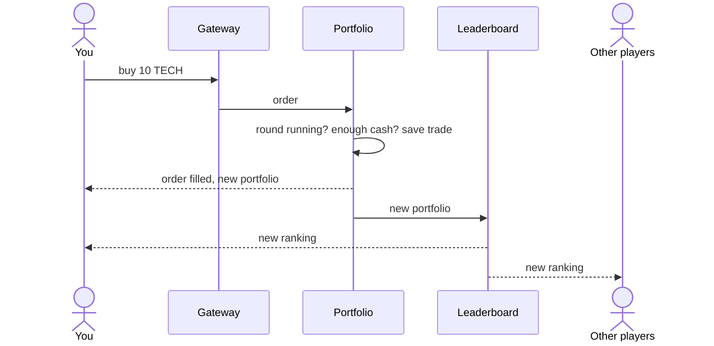
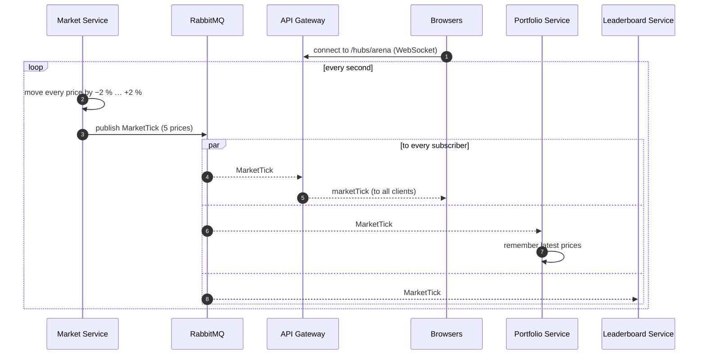
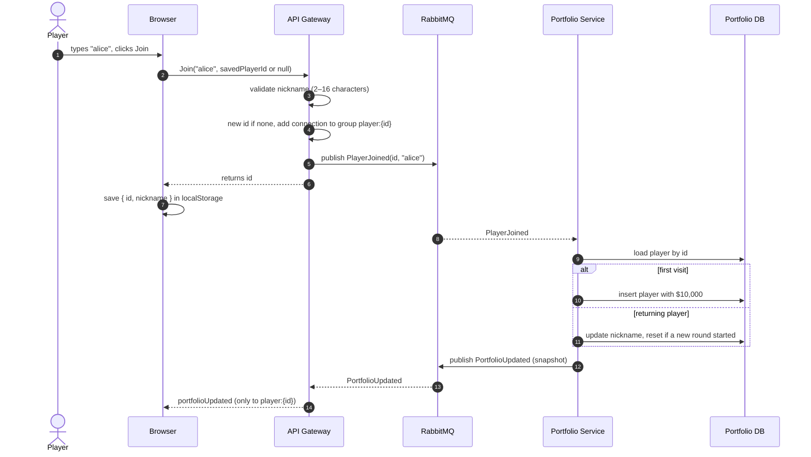
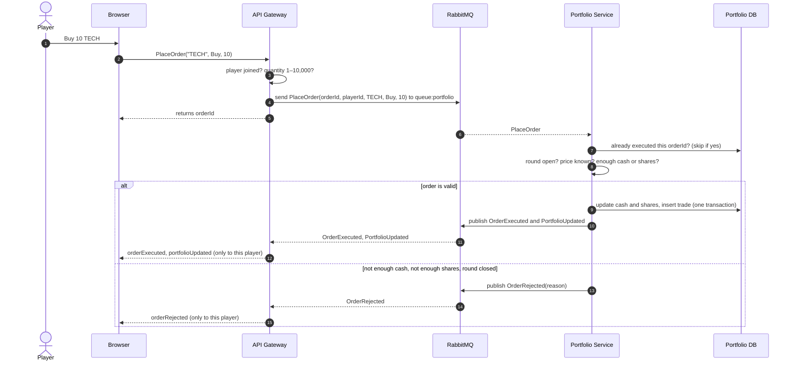
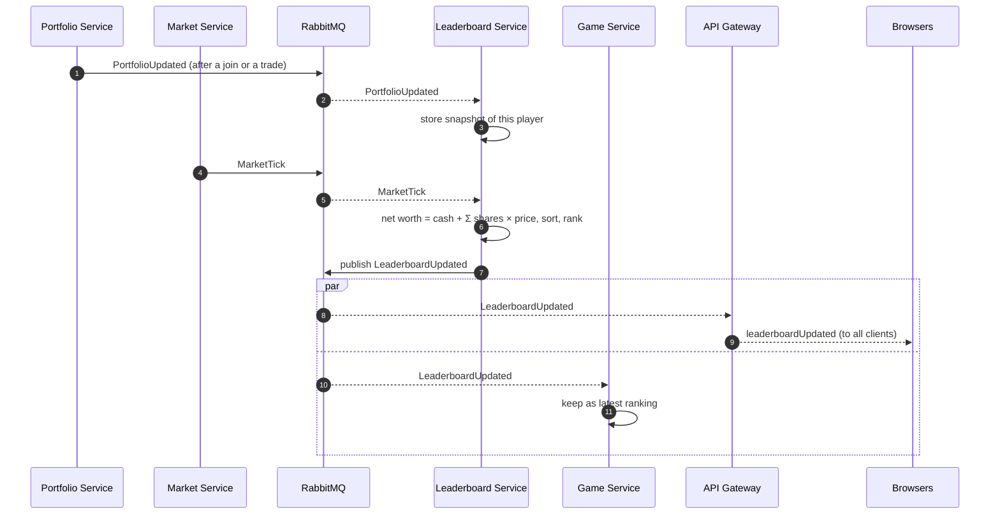
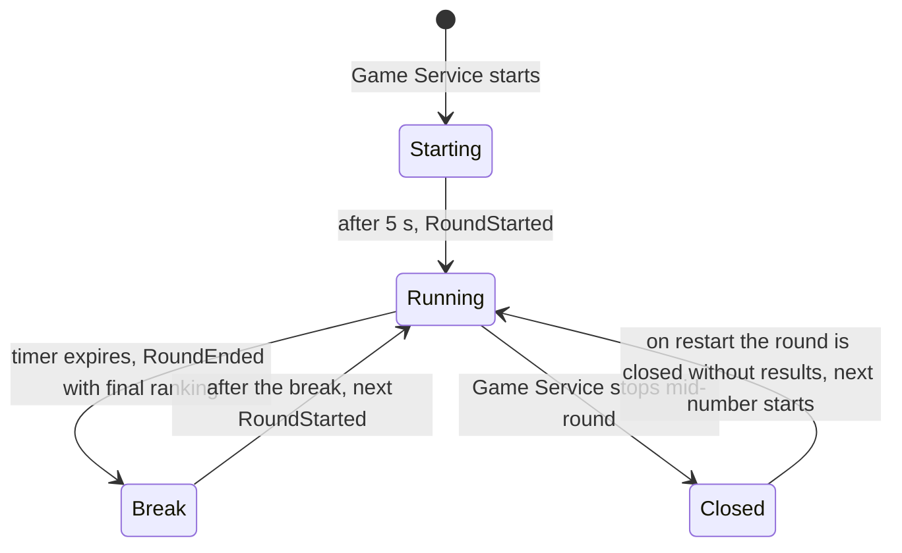
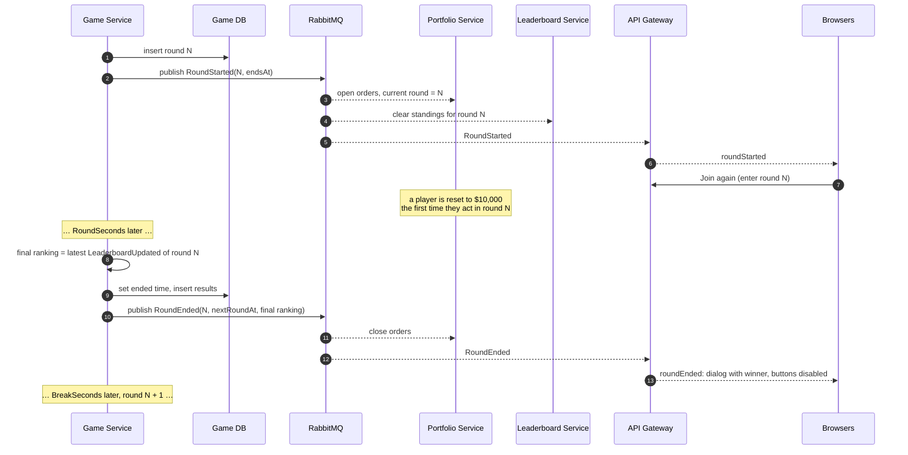
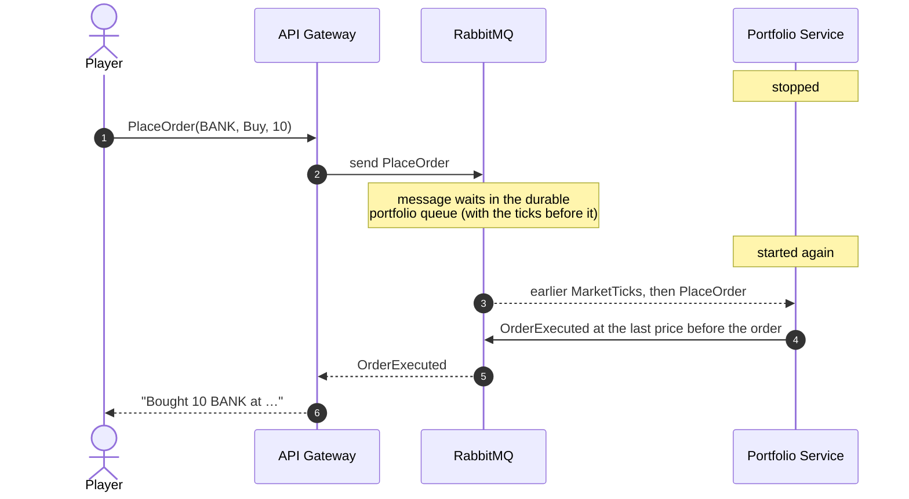

# 03 Communication

## In short: what happens when you click Buy

1. The browser tells the Gateway: "buy 10 TECH for this player".
2. The Gateway decides nothing itself. It passes the order on as a message to the Portfolio Service.
3. The Portfolio Service checks that the round is running and that the player has enough cash, using the last price it received from the Market Service. Then it saves the trade.
4. It announces the result ("order filled", or "rejected: not enough cash") together with the player's new portfolio.
5. The Gateway shows the result to that player only. Within a second the Leaderboard Service has recalculated the ranking, and every player sees the leaderboard move.

This is the simple picture. In reality every arrow between services passes through RabbitMQ, and everything that reaches a browser passes through the Gateway; the detailed flows below show each of those steps.

## Synchronous or asynchronous

| From → to | Style | Protocol | Used for |
|---|---|---|---|
| Browser → Gateway | Request/response | SignalR hub call over WebSocket | `Join`, `PlaceOrder` |
| Gateway → Browser | Push | SignalR over WebSocket | Prices, ranking, rounds, order results, portfolio |
| Browser → Gateway → Game | Request/response | HTTP GET | Current round and round history when the page opens |
| Service ↔ service | Asynchronous | RabbitMQ (AMQP) via MassTransit | Everything else |

The rule is simple: everything that changes something, and everything that happens on its own (ticks, rounds), travels as a message. Only two read-only queries use HTTP, because the page needs an answer right away when it opens and the answer is owned by the Game Service.

## Messages

All messages are C# records in `src/Contracts`. An **event** says that something already happened and may have any number of consumers. A **command** asks one specific service to do something and may be rejected.

| Message | Kind | Publisher | Consumers |
|---|---|---|---|
| `MarketTick` | Event | Market | Portfolio, Leaderboard, Gateway |
| `PlayerJoined` | Event | Gateway | Portfolio |
| `PlaceOrder` | **Command** | Gateway | Portfolio |
| `OrderExecuted` | Event | Portfolio | Gateway (to that player) |
| `OrderRejected` | Event | Portfolio | Gateway (to that player) |
| `PortfolioUpdated` | Event | Portfolio | Leaderboard, Gateway (to that player) |
| `LeaderboardUpdated` | Event | Leaderboard | Game, Gateway |
| `RoundStarted` | Event | Game | Portfolio, Leaderboard, Gateway |
| `RoundEnded` | Event | Game | Portfolio, Gateway |

## How RabbitMQ delivers the messages

Every service that is interested in a message type has its own queue in RabbitMQ, and it gets its own copy of every such message. When the Market Service publishes a `MarketTick`, RabbitMQ puts one copy into the Portfolio queue, one into the Leaderboard queue and one into the Gateway queue. The Market Service does not know who listens, so a new listener can be added without changing it. MassTransit sets this up automatically (one exchange per message type, with the interested queues bound to it).

The only exception is `PlaceOrder`: it is a command, so the Gateway puts it straight into the Portfolio queue.

| Queue | Durable | Processing | Why |
|---|---|---|---|
| `portfolio` | yes | one message at a time | Two orders of the same player can never run in parallel, and a new round is always handled before the orders sent after it. Messages wait here while the service is down. |
| `leaderboard` | yes | one message at a time | The in-memory standings need no locks, and events are applied in arrival order. |
| `game` | yes | default | Only stores the latest ranking. |
| `gateway_…` | no, deleted when the Gateway stops | default | Every Gateway instance has its own queue, so each instance receives every event and pushes it to its own browsers. Messages for browsers that are not connected are worthless, so nothing is kept. |

## Flow 1: live prices

The browser updates the price table and flashes every changed price green or red. `withAutomaticReconnect()` restores the connection after a network drop.

## Flow 2: joining the arena

This is the whole sign-in. On a page reload the browser sends the saved id, so the player gets the same portfolio back. The same call is made again after a reconnect and at the start of every round.

## Flow 3: placing an order

The order is executed at the price of the last `MarketTick` that reached the Portfolio Service before the order, which is the price the player saw on screen. Because ticks and orders arrive in the same queue, this is always well defined.

## Flow 4: live leaderboard

## Flow 5: rounds

Round numbers only grow. A player's portfolio stores the round it belongs to; when a player acts in a newer round, the Portfolio Service resets the cash to $10,000 and the shares to zero first. Players who do not come back in the new round simply do not appear in its ranking.

## When something goes wrong

RabbitMQ keeps a message until the receiving service confirms that it has handled it. If a service stops in the middle, the message is simply delivered again later. This means a message can occasionally arrive twice, so the services follow four small rules:

- **Try again on errors.** If saving to the database fails, the Portfolio Service tries again after 200 ms, 1 s and 3 s.
- **Only announce what is saved.** The result of an order is published only after the trade is stored in the database.
- **The same order never runs twice.** Every order gets its own id from the Gateway, and that id is also the key of the `Trades` table. A second copy of the same order finds the trade already there and is ignored.
- **Old news is ignored.** The Leaderboard Service ignores a portfolio snapshot that belongs to a round that is already over.

In course terms: RabbitMQ gives *at-least-once delivery*, and the Portfolio Service is an *idempotent consumer*.

What a player notices when one part stops:

| Stopped | Effect | After it comes back |
|---|---|---|
| Market Service | Prices freeze; orders still execute at the last price | Prices move again (they restart from the start values) |
| Portfolio Service | Orders and joins wait in the durable `portfolio` queue; no confirmation yet | All waiting messages are processed in order and the results reach the browser |
| Leaderboard Service | The ranking stops updating | It rebuilds from the next `PortfolioUpdated` events (joins, trades, the next round) |
| Game Service | The timer and the history are unavailable (`503` from `/api/rounds`); trading continues | The interrupted round is closed without results and a new round starts |
| API Gateway | Browsers show "Connecting…" and retry | Browsers reconnect, join again automatically and continue |
| RabbitMQ | Nothing moves between services | MassTransit reconnects every service automatically; durable queues keep their messages |

