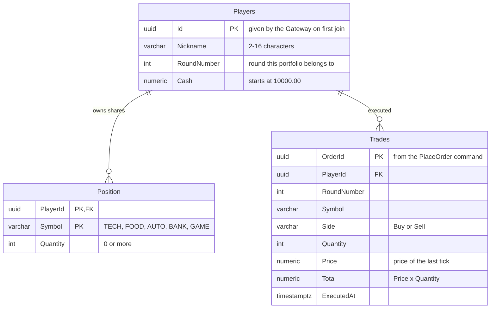
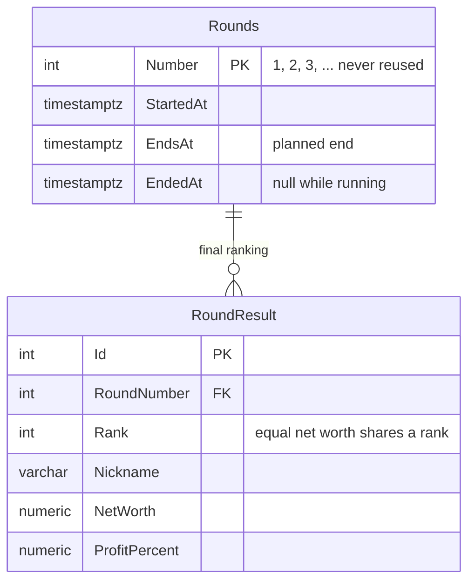

# 04 Data model

Two services persist data, each in its own PostgreSQL database on the same server. The schema is created by Entity Framework Core (`EnsureCreated`) when the service starts. Money is stored as `numeric(18,2)` and handled as `decimal` in C#, so there are no floating-point rounding errors.

## Portfolio database (`tradearena_portfolio`)

- **Players** holds the current round's cash. When a player acts in a newer round, `RoundNumber` is updated, `Cash` is set back to 10,000 and every position goes to 0.
- **Position** has one row per player and stock. A row whose quantity reaches 0 is kept, so buying the same stock again only updates it.
- **Trades** is the order history. Using the command's `OrderId` as the primary key makes a repeated delivery of the same order harmless.
- Cash, shares and the trade row are saved in one `SaveChanges` call, which is one database transaction.

## Game database (`tradearena_game`)

A round that was interrupted by a restart gets an `EndedAt` time but no results. Every player who joined a round is stored in its results, even without trading; the history endpoint only lists rounds in which at least one net worth moved away from $10,000.

## State kept in memory

Not everything needs a database. The following state is either a copy of data owned by another service or only meaningful while a connection is open.

| Where | State | Source | After a restart |
|---|---|---|---|
| Market Service | Current price and start price of each stock | Own simulation | Starts again from the start prices |
| Portfolio Service | `PriceBook`: latest price per stock | `MarketTick` | Filled by the next tick (queued ticks come first) |
| Portfolio Service | `RoundState`: current round number, orders open or closed | `RoundStarted`, `RoundEnded` | Round number restored from the database |
| Leaderboard Service | `Standings`: last snapshot per player, latest prices, round number | `PortfolioUpdated`, `MarketTick`, `RoundStarted` | Rebuilt from the next events |
| Game Service | `RoundClock`: what the timer is doing; `LatestStandings`: last ranking | Own timer, `LeaderboardUpdated` | A new round is started |
| API Gateway | SignalR group `player:{id}` for each connection | `Join` calls | Browsers reconnect and join again |
| Browser | `{ id, nickname }` in `localStorage` | Return value of `Join` | Kept by the browser until **Leave** |

## Message contracts

The messages are C# records in `src/Contracts`. [03 Communication](03-communication.md#messages) lists who sends and who receives each one, and [05 API reference](05-api-reference.md) shows how they look as JSON in the browser.

`PortfolioUpdated` always carries the **full** portfolio (cash and every holding), not just the change. A service that missed a message is correct again after the next one, and the Leaderboard Service never has to ask the Portfolio Service for anything.

## Validation rules

| Rule | Checked by |
|---|---|
| Nickname is 2–16 characters, no control characters | Gateway (`Join`) |
| The connection has joined before placing an order | Gateway (`PlaceOrder`) and Portfolio Service |
| Quantity is between 1 and 10,000 | Gateway; the Portfolio Service also rejects quantities below 1 |
| The round is running | Portfolio Service (the browser also disables the buttons) |
| The stock exists and has a price | Portfolio Service |
| Buy: price × quantity ≤ cash | Portfolio Service (`Player.Execute`) |
| Sell: quantity ≤ shares owned | Portfolio Service (`Player.Execute`) |
